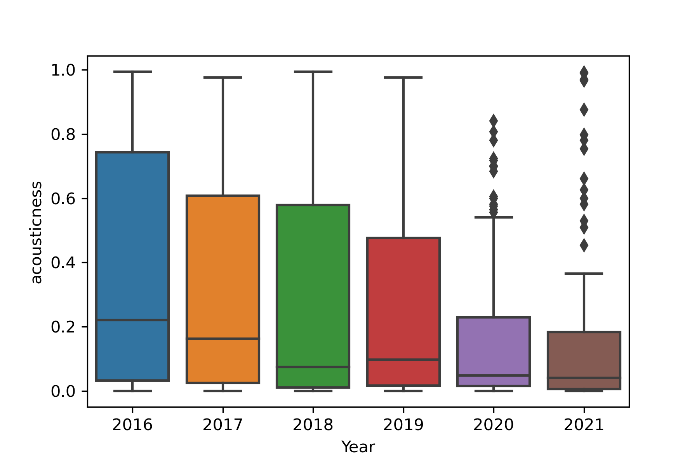

In this series of blog posts, I will discuss how my musical tastes have changed over the past six years using the data from my Spotify top songs playlists. In this first part, I will introduce the concept of Spotify's top songs feature and what my musical tastes were like before I started using Spotify. I will then briefly discuss the audio features associated with each song on Spotify. Then I will present the Python code I wrote to download my Top Songs playlists from 2016 - 2021, as well as the code used to organize and visualize the data. Finally, I will discuss how the acousticness of my top songs has changed over the years.

## Introduction
One of the things I love about Spotify is their summary playlists of the top 100 songs you listened to during the past year. These playlists are called "Your Top Songs (year)" and are usually created in early December of that year. I've been a Spotify premium subscriber since May/June 2014, but I don't have a record of my top songs from 2014 or 2015. However, I do have a record of my top songs from 2016 to 2021.

### My Musical Tastes Prior to Spotify

Before I met my wife, I pretty much just listened to video game and movie soundtracks and remixes of video game music made by the very talented folks at [OCReMix](https://ocremix.org). I exclusively used the [foobar2000](https://foobar2000.org) software with a classic 'green text on a black background' theme to listen to my music. I turned my nose up at any kind of pop, hip hop, or country music. I was so into OCReMix that I named my college radio show after it - The OCReMix Show with DJ Willdabeast. Shortly after we met, my wife introduced me to Spotify and to music that didn't come from a movie or video game. The OCReMix Show then became the OverClocked Fusion Show with DJ Willdabeast and DJ Supernova where video game music was played side-by-side with country, pop, hiphop, and rock/alternative. 

## Spotify Audio Features
Every song on Spotify can be characterized by the following metrics: acousticness, danceability, duration, energy, instrumentalness, key, liveness, loudness, mode, speechiness, tempo, time signature, and valence. A description of each audio feature is below for your convenience. I lifted some of the language from Spotify's official [documentation](https://developer.spotify.com/documentation/web-api/reference/#/operations/get-audio-features).

* Acousticness is the confidence that a track is acoustic (0.0 - not acoustic, 1.0 - acoustic). Acoustic music primarily uses instruments that don't use electricity to produce sound such as the trumpet, saxophone, clarinet, acoustic guitar, piano, violin, etc.

* Danceability is the confidence that a track is suitable for dancing (0.0 - least danceable, 1.0 - most danceable). This metric combines several musical elements including tempo, rhythm stability, beat strength, and overall regularity.

* Duration is the length of the track.

* Energy describes the intensity and activity of a track (0.0 - very low energy, 1.0 - very high energy). Classical music scores low while metal music scores high. This metric combines several elements including dynamic range, perceived loudness, timbre, onset rate, and general entropy.

* Instrumentalness is the confidence that a track contains no vocals other than "oohs" or "aahs" (values greater than 0.5 likely contain no vocals, but confidence increases as the value approaches 1.0). 

* Key - the key the track is in. From Spotify's docs, "Integers map to pitches using standard Pitch Class (https://en.wikipedia.org/wiki/Pitch_class) notation. E.g. 0 = C, 1 = C♯/D♭, 2 = D, and so on. If no key was detected, the value is -1."

* Liveness is the confidence that a track was performed live (0.0 - recorded in studio, > 0.8 - likely song was recorded live).

* Loudness is the loudness of the track. This value is the average loudness of the track and thus allows comparison between tracks. 

* Mode indicates whether a given track is major or minor key (0 - minor, 1 - major).

* Speechiness is the confidence that a track primarily consists of speech. Values greater than 0.66 are likely all spoken words. Values between 0.33 and 0.66 contain a mix of music and speech. Values below 0.33 contain music with sung vocals.

* Tempo is the overall tempo of a track in beats per minute (BPM).

* Time signature indicates how many beats are in each measure. Values range from 3 to 7 which indicate "3/4" to "7/4" time.

* Valence describes the musical positiveness of a track (0.0 - negative, 1.0 - positive). From Spotify's docs: "Tracks with high valence sound more positive (e.g. happy, cheerful, euphoric), 
while tracks with low valence sound more negative (e.g. sad, depressed, angry)."


## Python Code
Using the power of Python and the [Spotify API](https://developer.spotify.com/documentation/web-api/), I downloaded my top songs from 2016 to 2021 along with their audio features as CSV files. Once I had my top songs playlists downloaded with the associated audio features, I collected them together using pandas and then used Seaborn to generate box-and-whisker plots of each year's data side-by-side.

Below is the data extraction script. I used the requests library to interface with the API and the pandas library to convert the list of dicts to a CSV file.
```python
# -*- coding: utf-8 -*-
"""
@author: wapisani

This script will download my top songs from 2016 to 2021 and save them to 
CSV files.
"""

import requests, os
import pandas as pd

def GetAllTracksInfo(playlist_id,authorization_header):
    """
    Parameters
    ----------
    playlist_id : String
        Spotify playlist ID.
    authorization_header : dict
        The standard Spotify API authorization header.

    Returns
    -------
    tracks : list 
        List of dicts with each dict containing information about a song.

    """
    # base URL of all Spotify API endpoints
    BASE_URL = 'https://api.spotify.com/v1/'
    track_json = requests.get(BASE_URL + 'playlists/' + playlist_id + '/tracks',headers=authorization_header).json()
    tracks = []
    
    for track in track_json['items']:
        track = track['track']
        track_info = requests.get(BASE_URL + 'audio-features/' + track['id'],headers=authorization_header).json()
        track_info.update({
                            'track_name': track['name'],
                            'release_data': track['album']['release_date'],
                            'album_name': track['album']['name'],
                            'popularity': track['popularity']})
        
        artists = [] # To handle multiple artists
        for artist in track['artists']:
            artists.append(artist['name'])
        artists_str = ', '.join(artists)
        
        track_info.update({
            'artists': artists_str})
        
        tracks.append(track_info)
    
    return tracks

# Use this URL to get an access token: https://developer.spotify.com/console/get-recommendations/
# Scroll to the bottom and click "Get Token" then select "playlist-modify-private" as the scope
access_token = ''

headers = {
    'Authorization': 'Bearer {token}'.format(token=access_token)
}

# base URL of all Spotify API endpoints
BASE_URL = 'https://api.spotify.com/v1/'

# My Top Songs = MTS
MTS2016_ID = '2016_playlist_id'
MTS2017_ID = '2017_playlist_id'
MTS2018_ID = '2018_playlist_id'
MTS2019_ID = '2019_playlist_id'
MTS2020_ID = '2020_playlist_id'
MTS2021_ID = '2021_playlist_id'

MTS2016_tracks = GetAllTracksInfo(MTS2016_ID, headers)
MTS2017_tracks = GetAllTracksInfo(MTS2017_ID, headers)
MTS2018_tracks = GetAllTracksInfo(MTS2018_ID, headers)
MTS2019_tracks = GetAllTracksInfo(MTS2019_ID, headers)
MTS2020_tracks = GetAllTracksInfo(MTS2020_ID, headers)
MTS2021_tracks = GetAllTracksInfo(MTS2021_ID, headers)

os.chdir(r'F:\Documents\Programming\Python\python-projects\Spotify')

df2016 = pd.DataFrame(MTS2016_tracks)
df2016.to_csv('MTS2016.csv')
df2017 = pd.DataFrame(MTS2017_tracks)
df2017.to_csv('MTS2017.csv')
df2018 = pd.DataFrame(MTS2018_tracks)
df2018.to_csv('MTS2018.csv')
df2019 = pd.DataFrame(MTS2019_tracks)
df2019.to_csv('MTS2019.csv')
df2020 = pd.DataFrame(MTS2020_tracks)
df2020.to_csv('MTS2020.csv')
df2021 = pd.DataFrame(MTS2021_tracks)
df2021.to_csv('MTS2021.csv')
```

Below is the data analysis script.

```python
# -*- coding: utf-8 -*-
"""
@author: Will Pisani, PhD

This script will analyze My Top Songs from 2016 to presently available data.
"""
from collections import Counter
import pandas as pd
import matplotlib.pyplot as plt
import seaborn as sns
import os

directory = r'F:\Documents\Programming\Python\python-projects\Spotify'
os.chdir(directory)
years = ['2016','2017','2018','2019','2020','2021']

# Combine all years into one data frame
dataframes = []
for year in years:
    dataframes.append(pd.read_csv(f'MTS{year}.csv').assign(Year=int(year)))
df = pd.concat(dataframes)

# Get averages and standard deviations of each characteristic by year
mean_df = df.groupby(['Year']).mean()
std_df = df.groupby(['Year']).std()

cols = df.columns

# Add duration in minutes to the dataframe
df['duration_min'] = df['duration_ms']/1000/60
features = ['acousticness','danceability','duration_min','energy','instrumentalness',
            'key','liveness','loudness','mode','speechiness','tempo','time_signature',
            'valence']

# Spotify's official docs on the audio features
# https://developer.spotify.com/documentation/web-api/reference/#/operations/get-audio-features

os.chdir(r'F:\Documents\Programming\Python\python-projects\Spotify\My_Top_Songs_Plots')
for feature in features:
    fig, ax = plt.subplots()
    ax = sns.boxplot(x="Year",y=feature,data=df)
    fig.savefig(f'My_Top_Songs_Box_Plot_{feature}.png',dpi=300)
```


## My Top Songs Analysis - Acousticness

Now let's talk about the first audio feature - acousticness!

<figure>
   
   <figcaption>Figure 1. Acousticness of Will Pisani's top songs as a function of time. The confidence that a song is acoustic increases as the value increases.</figcaption>
</figure>
 As you can see, the acousticness of my top songs has steadily decreased over the years with a large decrease in Q3 from 2019 to 2020. It's clear I listened to significantly more music with electronic elements than orchestral elements. The more I listened to music on Spotify and discovered more music, the less I listened to orchestral/acoustic music.
 <br /><br />
 
 In all years but 2020, my top songs spanned the entire acousticness range. In 2020, the maximum acousticness value was 0.841 while the other years were greater than 0.97. Most songs had an acousticness value less than 0.2. So what happened with 2020? Well, the COVID-19 pandemic happened. 2020 was a dark time for me and I started listening to a lot more pop, rock, pop-rock, and pop-punk (enough that I made a pop-rock/pop-punk playlist in Sept 2020). Acoustically, 2021 was a continuation of the downward trend, but there were 16 songs that could be considered outliers. These songs actually spanned several different genres from video game music (a "City of Tears" cover from the video game "Hollow Knight") to pop (Taylor Swifts's "Cornelia Street") to pop-punk (Halflives' "Fugitive (Reimagined)"). It will be interesting to see if 2022 has a similar range as 2021 and 2020 or if it will be larger. I will try to remember to update this post with the acousticness values from 2022.

## Conclusion
In this post I introduced the concept of Spotify Top Songs and the audio features associated with each track on Spotify. I presented the Python code I wrote to download and organize my top songs and their audio features, and the Python code I wrote to make box-and-whisker plots. I discussed the acousticness of my top songs from 2016 to 2021 and how it has changed. In the next post, I will discuss danceability, duration, and energy of my top songs 2016 - 2021.