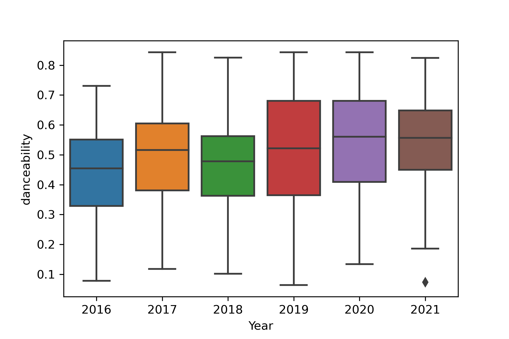
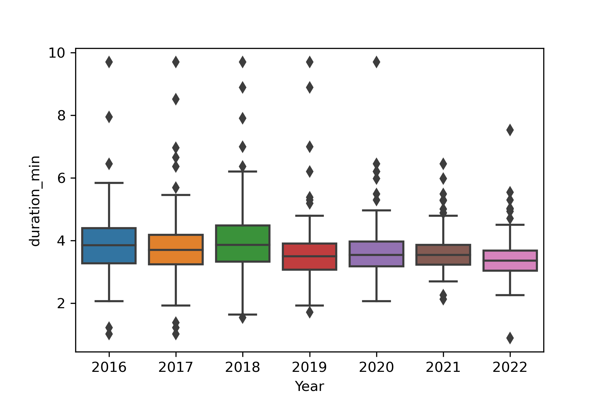

Hi! Welcome to part 2 of my series on analyzing my Spotify top songs from 2016 to 2022. If you're reading this series for the first time today, on Spotify there are audio features that every song has: acousticness, danceability, duration, energy, instrumentalness, key, liveness, loudness, mode, speechiness, tempo, time signature, and valence. Last time I talked about the acousticness of my top songs. Now let's discuss danceability and duration.

### Danceability

Per Spotify's official [documentation](https://developer.spotify.com/documentation/web-api/reference/#/operations/get-audio-features), danceability is the confidence that a track is suitable for dancing (0.0 - least danceable, 1.0 - most danceable). This metric combines several musical elements including tempo, rhythm stability, beat strength, and overall regularity.

<figure>
   
   <figcaption>Figure 1. Danceability of Will Pisani's top songs as a function of time. The confidence that a song is suitable for dancing increases as the value increases.</figcaption>
</figure>

### Duration
Duration is the length of the track.

<figure>
   
   <figcaption>Figure 2. Duration of Will Pisani's top songs as a function of time.</figcaption>
</figure>

### Conclusion
